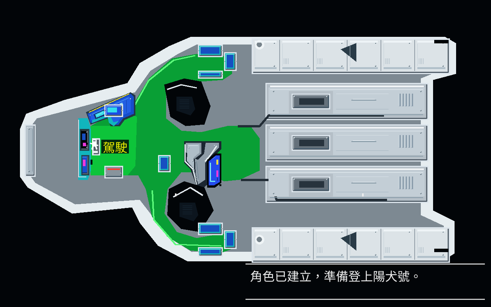
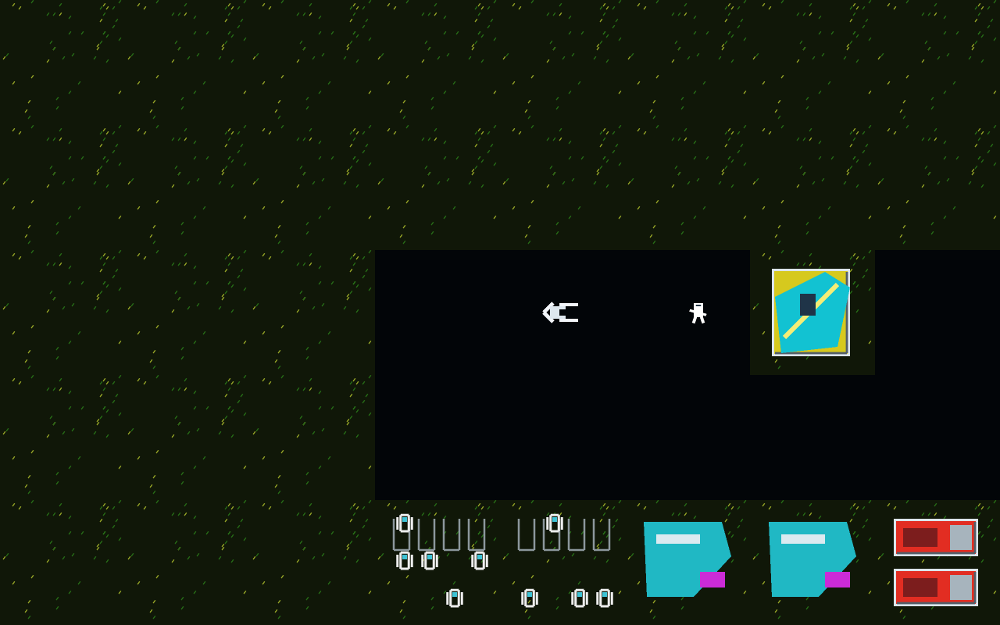
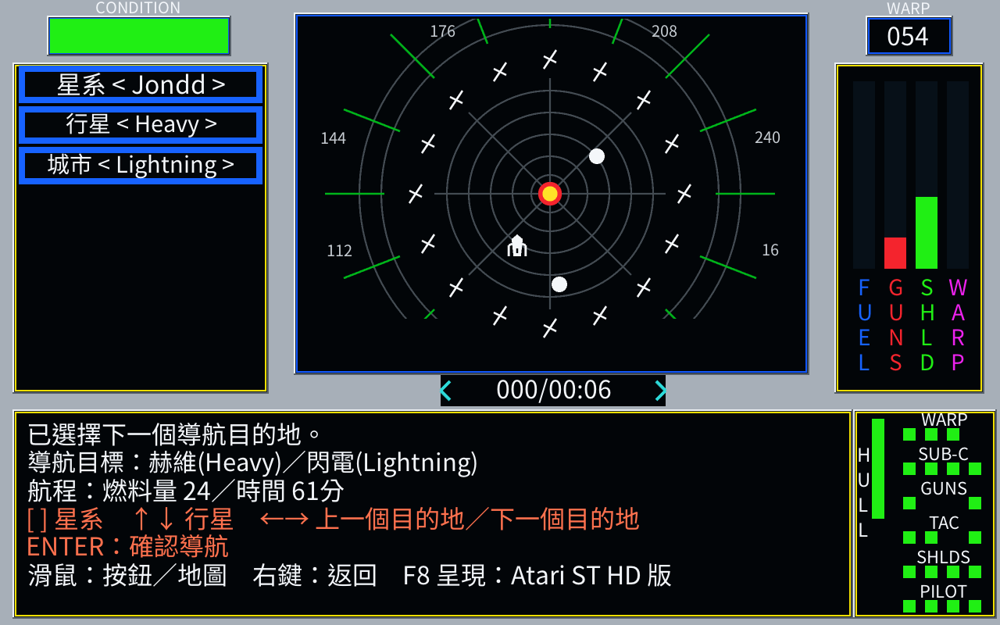
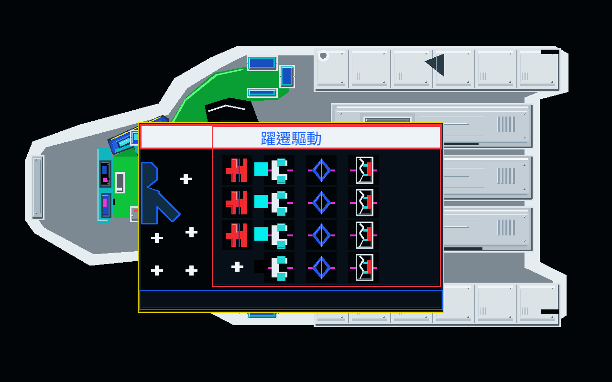
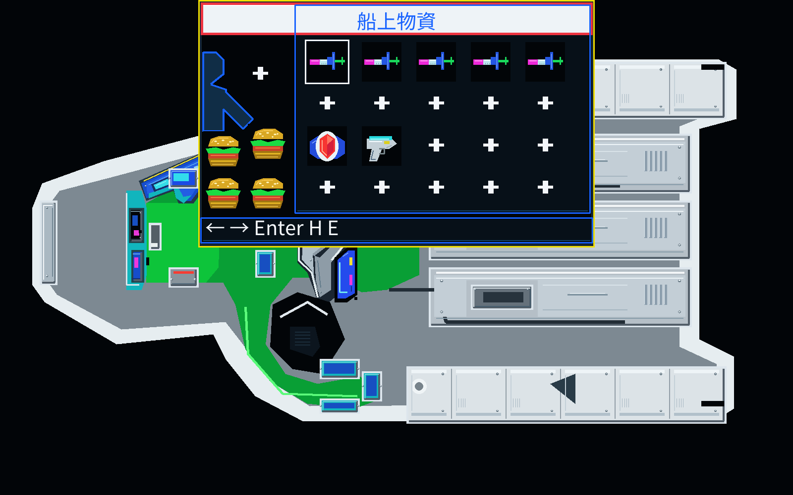
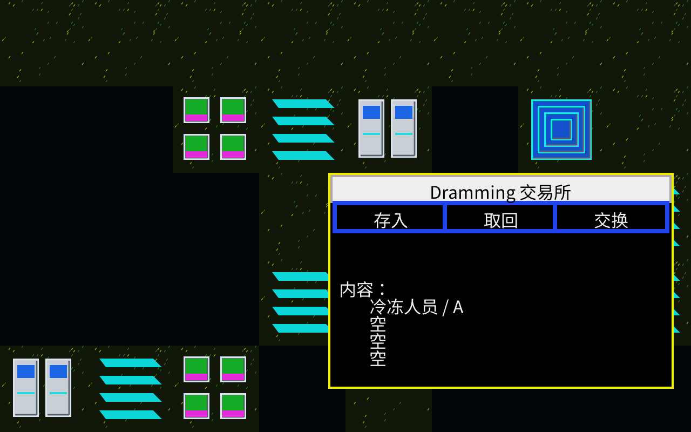
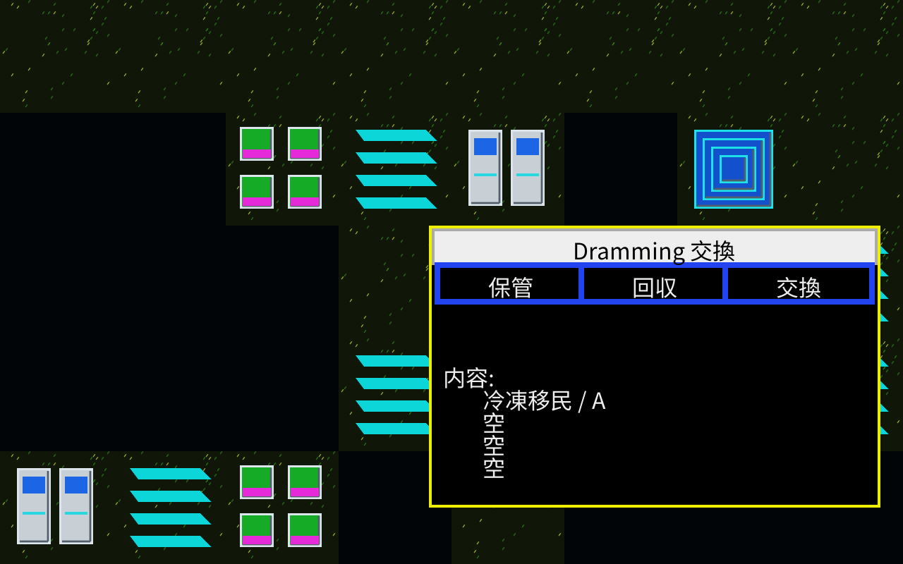
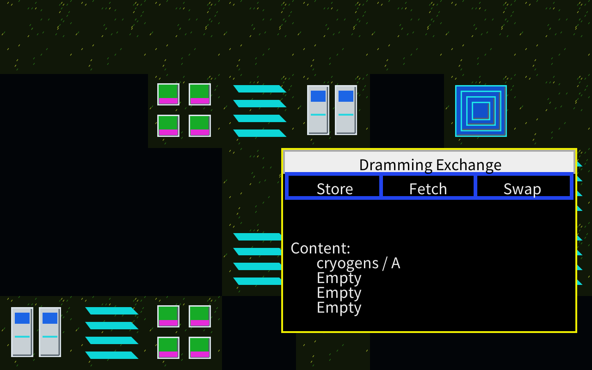

# SunDog: Atari ST HD 리메이크

[繁體中文](README.md) · [日本語](README.ja.md) · [한국어](README.ko.md) · [English](README.en.md)

Go와 Ebitengine으로 다시 만든 우주 무역 모험 게임입니다. Atari ST의 화면 구성을 바탕으로 독립 HD 미술을 추가했습니다. 번체 중국어, 간체 중국어, 일본어, 한국어, 영어를 지원합니다.

현재 버전은 **v.1.2.0-20261016**입니다. 플레이하려면 합법적으로 보유한 Atari ST `sundog.st` 디스크가 필요합니다. 공개 소스와 엔진 배포물에는 원본 디스크, 그림, 음향, 설명서 스캔이 포함되지 않습니다. 기존 비공개 저장소의 이력, 비교 이미지와 이전 Release는 비공개로 보존합니다.

## 이야기

무대는 Jebal 제국 보호령의 Drahew 지역입니다. 12개 성계와 18개 유인 행성 사이를 상선이 오가며 생활 물자와 개척 자재를 운반합니다. 당신은 화물선 SunDog의 선장이 되어 우주항에서 거래하고 낯선 세계를 찾아갑니다.

주인공 Zed는 유리 광산에서 일하던 노동자였습니다. 왕래가 없던 삼촌 Brock Dor-Ceed가 죽자, 낡은 우주 화물선 한 척과 여러 성계에 흩어진 은행 계좌의 암호를 물려받습니다. 광산을 떠나 자신의 삶을 선택할 첫 기회였습니다.

하지만 유산에는 삼촌의 빚과 끝내지 못한 개척 계약도 딸려 있었습니다. Jondd의 Banville 개척지를 찾아 건설 물자를 납품하고, 각지 창고의 냉동 이주민을 데려와야 합니다. 무역으로 연료비와 수리비를 마련하며 다음 항해를 준비하세요. 해적은 화물을, 거리의 강도는 현금을 노립니다. 함선을 유지하고 개척지를 키워야 Zed의 새로운 자유도 지킬 수 있습니다.

이 소개는 Atari ST판 《SunDog: Frozen Legacy》 설명서 3–4쪽을 요약했습니다. 설명서와 스캔은 배포하지 않습니다. Zed는 설명서의 주인공 이름이며, 게임에서는 직접 이름을 지을 수 있습니다.

## Atari ST HD

밝은 색, 함선의 윤곽, 화면 구역과 조작 의미를 유지하며 제목, 선실, 항행, 도시, 행성 지표, 실내, 인물, 물품, 기관실, 전술, 각종 시설과 결말을 새로 그렸습니다. 독립 미술에는 타일 330개, 실내 배경 17종, 물품 아이콘 31종과 빈 슬롯이 포함됩니다.

`F8`을 누르면 **Atari ST → Atari ST HD → Apple II** 순서로 바뀝니다. 기본값은 Atari ST입니다. 선택은 저장되며 `F2`에서도 바꿀 수 있습니다. 원본 표시의 그림은 플레이어가 보유한 디스크에서 읽습니다.

| 도시와 정박 함선 | 성계 항행 |
|---|---|
|  |  |
| 기관실 | 함내 물자 |
|  |  |

이미지는 정식 통합 후보를 일반 조작으로 플레이하며 캡처했습니다. 서로 다른 진행 분기에서 가져왔으며 같은 상태의 원작 비교를 뜻하지 않습니다. 파일 해시는 [공개 소스 목록](PUBLIC-SOURCE-MANIFEST.json)에 기록되어 있습니다.

## 5개 언어의 HD 게임 화면

동일한 저장 데이터를 불러온 Dramming 창고에서 게임 설정으로 언어를 바꾸며 촬영했습니다. 이미지를 누르면 1280×800 원본을 볼 수 있습니다.

<table>
<tr>
<td> 繁體中文</td>
<td> 简体中文</td>
</tr>
<tr>
<td> 日本語</td>
<td> 한국어</td>
</tr>
<tr>
<td> English</td>
</tr>
</table>

현재 소스에서 일반 조작으로 저장 데이터를 불러와 촬영한 무편집 화면입니다. 창고의 교환 기능은 v.1.2.0-20261016 출시 후 추가되어 해당 버전의 배포 패키지에는 포함되지 않습니다. 이미지 해시는 [공개 소스 목록](PUBLIC-SOURCE-MANIFEST.json)에 기록되어 있습니다.

## 다운로드와 언어 설정

[v.1.2.0-20261016 엔진](https://github.com/wicanr2/sundog-remake-zh-hant-public/releases/tag/v.1.2.0-20261016)을 받거나 [Docker 빌드 안내](docs/build.md)에 따라 컴파일하세요. 실행 후 합법적으로 보유한 `sundog.st`를 선택합니다. 자신의 디스크에서 효과음을 가져오기 전에는 무음입니다.

`F2`를 열고 언어 행에서 `←` / `→`로 바꾸면 바로 적용됩니다. 재시작 후에도 설정이 유지됩니다. `-locale ko`, `-locale ja`, `-locale en`으로 실행할 수도 있습니다. 언어는 게임 진행이나 저장 데이터를 바꾸지 않습니다. 자세한 내용은 [언어 자료 안내](docs/i18n/README.md)를 참고하세요. AI를 활용한 번역이며, 원어민 편집자의 전체 교정은 아직 하지 않았습니다.

| 플랫폼 | 검증 범위 |
|---|---|
| Linux x86_64 | 일반 실행, 표시 전환, 저장과 재실행 |
| Windows x64 | Wine에서 실행 스크립트 및 저장 확인. 실제 Windows 미검증 |
| macOS Intel / Apple Silicon | 아키텍처와 서명 정적 검사. 실제 Mac 미검증 |

원본 자료가 들어 있는 완전판과 음향 시연 영상은 로컬 전용입니다.

## 조작

| 동작 | 키 |
|---|---|
| 도움말 / 설정 / 음소거 | `F1` / `F2` / `F7` |
| 표시 / 인물 저장소 | `F8` / `F5` |
| 돌아가기 / 저장 후 종료 | `Esc` 또는 우클릭 / `Q` 또는 `F10` |
| 선실 기능 | `N` 항행, `X` 전술, `E` 기관실, `B` 물자, `C` 화물, `H` 상태, `G` 하선 |
| 이동 / 확인 | 방향키 또는 마우스 / `Enter` 또는 `Space` |
| 인물 저장소 | `M` 만들기, `N` 새 게임, `1`–`8` 슬롯, `S` 저장, `L` 불러오기 |

화면별 조작은 `F1`에서 확인할 수 있습니다. 이름을 입력하는 동안 문자 키는 이름 입력에 쓰이며, 종료하려면 `F10`을 누르세요. 소스 main은 schema45 새 저장을 지원하며 기본 파일명에 v45가 포함됩니다. 배포된 v.1.2.0-20261016은 schema44를 사용합니다. 기존 저장은 구버전용으로 보관하며 변환하지 않습니다. 저장소와 설정 위치는 Linux `~/.config/sundog-remake/`, Windows `%APPDATA%\sundog-remake\`, macOS `~/Library/Application Support/sundog-remake/`입니다.

## 검증과 라이선스

일반 플레이 표본 검증은 인물 생성, 선실 기능, 항행, 지상 이동, 도시 시설, 실내, 항행 중 수면, 점수 정산, 실패 결말, 저장과 다시 불러오기를 포함합니다. 여러 언어와 창 크기의 렌더링도 검사했습니다. 소스 main은 모드 1~7과 은폐 장치를 끈 모드 0의 항로 변경 카운트다운, 사격 준비와 갱신 사이의 상태를 유지하며, 원작 데이터의 적 함선 7종에 대해 난수 입력을 통제한 연속 처리 비교를 통과했습니다. 낮은 실드에서의 관통 피해도 비교를 통과했습니다. schema45의 정상 조작으로 HD 패배와 다시 불러오기를 한 사례 확인했습니다. 선체가 0이 되면 남은 관통 피해 계산을 즉시 중단하도록 수정하고, 준비된 치명 공격을 비교했습니다. 원작 사망 처리 전체와 화면, 모든 조우 및 승패 분기는 아직 검증하지 않았습니다. 은폐 장치를 켠 모드 0은 기존 근사 처리를 유지하며 전체 전투의 일치는 아직 검증되지 않았습니다. [전투 구현](internal/game/enemy_course.go)을 참고하세요. 원작 GUI의 모든 동작, 자연 난수열의 일치, 모든 전투 분기, Windows/macOS 실기 및 청각적 동기화에는 미검증 영역이 남아 있습니다. 게임 전체의 픽셀 또는 프레임 단위 일치를 주장하지 않습니다.

[문서 색인](docs/index.md)과 [현재 상태](CONTEXT.md)가 안내 입구입니다. 일부 연구 도구는 비공개 증거를 참조하며 별도로 합법적인 입력 자료가 필요합니다.

직접 작성한 코드, 도구, 번역과 독립 미술에는 [RRSAL-1.0](LICENSE)이 적용됩니다. 글꼴은 [출처 및 라이선스](assets/fonts/ASSET-MANIFEST.md)의 개별 조건을 따릅니다. 라이선스의 번체 중국어 본문이 정본입니다.

《SunDog: Frozen Legacy》와 원본 자료의 권리는 각 권리자에게 있습니다. 이 프로젝트는 독립 연구 리메이크이며 원작 개발사와 제휴 관계가 없습니다. 프로젝트 라이선스가 원본 자료의 재배포 권리를 부여하지는 않습니다.
